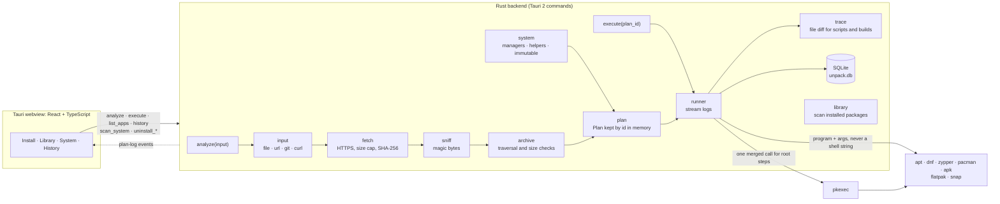
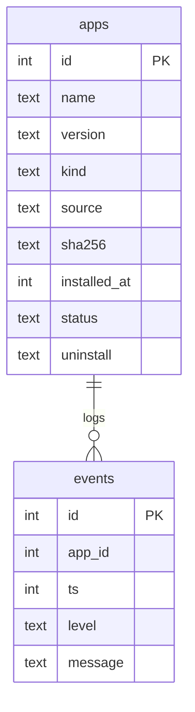

<h1 align="center"></h1>


Install anything on Linux. Drop in a package, archive, script, git address or a pasted `curl` / `wget`
command; Unpack works out what it is, builds a plan for your distro, shows it to you, runs it, tracks it in
SQLite, and can uninstall it later. Made for people new to Linux, who should not need to know which of
`apt`, `dnf`, `pacman` or `flatpak` they are on.

- **Drop or paste anything**: a file, a path, an `https://` link, a git URL, or `curl -fsSL … | sh`
- **Read before run**: every install shows a plan (what the file is, the exact commands, whether admin rights are needed) and nothing runs until you press *install*
- **Native first**: `.deb`, `.rpm`, Arch packages, Alpine `.apk`, `.snap`, `.flatpak`, `.AppImage`, `.run`, `.sh`, archives, source trees and `.dsc`
- **Detects capabilities, not distro names**: looks for the package managers and helpers that exist, and for a read-only base system
- **Live progress**: per-step install progress, an Output panel that streams as it runs, and a status bar with the running task
- **One admin prompt**: root steps are merged into a single `pkexec` call; if no password window can appear, Unpack shows the exact `sudo` command to run instead
- **Tracked and reversible**: every install records how to remove it, and removal offers to delete the settings and cache folders the app left behind; the Library also lists packages you installed some other way
- **Desktop app or command line**: the same engine as `unpack install file.deb`, `unpack list`, `unpack remove`; a static command-line build runs on any distro, even without a desktop
- **Updates**: checks GitHub releases on a stable, beta or alpha channel; an AppImage updates itself, a `.deb`/`.rpm` is downloaded and opened in your installer
- **History** of everything Unpack did and when
- **Safe by design**: the UI never sends command lines, archives are checked for path traversal, files are re-hashed before running, and `--allow-untrusted` style flags are never passed silently
- **Familiar, quiet look**: VS Code style window with its own draggable titlebar, activity bar, tabs and status bar; light and dark; an animated start-up logo and animations that respect *reduced motion*

Research and design: [`development/docs/README.md`](development/docs/README.md).
Architecture: [`development/docs/04-architecture.md`](development/docs/04-architecture.md), summarised [below](#how-it-fits-together).
Security model: [`development/docs/05-security.md`](development/docs/05-security.md).
Progress: [`development/TODO.md`](development/TODO.md).

> **Early software.** The core has unit tests (54 pass), and the command line installs, tracks and removes
> real packages on Debian, Ubuntu, Fedora, Rocky Linux, openSUSE, Arch and Alpine in Docker
> (`scripts/test-distros.sh`). The desktop parts (password window, menu entries, AppImage, Flatpak, Snap) have
> not been run on each of those desktops yet; see M5 in the TODO. Facts not yet checked on a real system are
> marked **(unverified)** in the docs.

## Walkthrough

<p align="center"></p>

Full film (43 s, 1440x2560): [`Unpack.mp4`](Unpack.mp4).

## How it fits together



The webview never sends a command. It asks the backend to `analyze` an input, gets a plan back, and asks
it to `execute` that plan by id. Commands are `program + args` vectors; a shell is used only to merge root
steps, and its arguments are quoted with `shlex`.

### Data model



`apps.uninstall` holds the removal recipe as JSON: `Manager` (apt, dnf, zypper, pacman, apk, snap, flatpak),
`Files` (AppImages, portable archives, traced scripts and builds), `Traced` (filled in after a run from a
before and after diff of `~/.local`, `/opt` and `/usr/local`) or `Manual` (nothing safe can be derived).
The database lives at `~/.local/share/unpack/unpack.db`.

## Formats

| Input | What Unpack does |
|---|---|
| `.deb`, `.rpm`, `.pkg.tar.zst`, `.apk` (Alpine) | Installs with the native manager when the system has it, otherwise explains what is missing |
| Android `.apk` | Rejected with an explanation |
| `.snap`, `.flatpak`, `.flatpakref`, `.flatpakrepo` | Installs with `snap` or `flatpak --user` |
| `.AppImage` | Copies to `~/Applications`, makes it executable, adds a menu entry and icon, checks FUSE 2 |
| `.run`, `.bin`, `.sh` | Shows the script, runs it only after you agree, traces the files it creates |
| `.tar.*`, `.zip`, `.7z`, `.gz`, `.xz`, `.bz2`, `.zst` | Checks members, extracts, installs portable apps to `~/.local/opt` with a launcher |
| Source tree, git URL, `.dsc` | Detects the build system (autotools, CMake, Meson, Cargo, Go, Python, Node, `PKGBUILD`, `debian/`), builds, then installs the result natively |
| `curl … \| sh`, `wget -O …` | Never run as pasted. Downloads the file itself, hashes it, shows it, then classifies it like any other file |

Per-format detail, traps and removal rules: [`development/docs/02-formats.md`](development/docs/02-formats.md).
Distros, package managers and read-only systems: [`development/docs/03-distro-compat.md`](development/docs/03-distro-compat.md).

## Admin rights

Unpack never runs as root. Steps are tagged when they need it (system package installs, writes to `/opt`,
removal of root-owned files), and consecutive root steps are merged into **one** `pkexec` prompt. User-scope
options (`flatpak --user`, `~/.local`) are preferred whenever the format allows.

| What happens | What you see |
|---|---|
| Password window opens | *Waiting for the admin password…* in the log and status bar |
| You close the window | A clear message that nothing needing admin rights ran |
| Refused, or no polkit agent in this desktop session | The reason, plus the exact `sudo sh -c …` command with a copy button |
| `pkexec` is not installed | The same terminal command, and a warning in the plan before you start |
| Unpack itself was started as root | A warning on the System page: user-scope apps would be installed for root |

## Install

For the current user, x86_64 or aarch64, no root: the newest AppImage, a menu entry with the Unpack icon and an `unpack` command. The app then keeps itself up to date.

```bash
curl -fsSL https://raw.githubusercontent.com/aiyu-ayaan/Unpack/master/scripts/install-linux.sh | sh
# ... | sh -s -- --channel beta     beta builds too (or alpha)
# ... | sh -s -- --version 0.0.1    one specific release
# ... | sh -s -- --uninstall        remove it; history and settings are kept
```

With no stable release yet, it falls back to the newest beta, then alpha, and says so. Re-run it to update.

### Command line only

No desktop, a server, or you just prefer a terminal: one static binary for x86_64 or aarch64 that runs on any distro (glibc or musl).

```bash
curl -fsSL https://raw.githubusercontent.com/aiyu-ayaan/Unpack/master/scripts/install-linux.sh | sh -s -- --cli
```

It goes to `~/.local/share/unpack/unpack-cli` with an `unpack` command in `~/.local/bin`. Or download `unpack-cli_<version>_<arch>` from the [releases page](https://github.com/aiyu-ayaan/Unpack/releases), `chmod +x` it and run it. The desktop app's own `unpack` command takes the same commands, so you do not need both.

It checks what the system has, not which distro it is: any x86_64 or aarch64 glibc distro works. If `libfuse2` is missing (recent Ubuntu, Debian and Fedora do not ship it) the AppImage runs in extract-and-run mode, so nothing has to be installed first. musl systems such as Alpine cannot run an AppImage, so there the script installs the `-musl.tar.gz` the release builds on Alpine (WebKitGTK and GTK come from `apk`, which asks for `sudo` or `doas`). With no such file in the releases, or with `--from-source`, it builds Unpack from source with `scripts/build-musl.sh`, which takes a while. A `.deb` or `.rpm` from the release page works too.

## Requirements

- Linux with at least one of `apt`, `dnf`, `zypper`, `pacman`, `apk`, `flatpak` or `snap`
- `polkit` (for `pkexec`) to get a graphical admin prompt
- To build: Rust (stable, `cargo`), Node.js 18+, `pnpm`, and the Tauri system libraries

On Debian / Ubuntu:

```bash
sudo apt install libwebkit2gtk-4.1-dev libgtk-3-dev libayatana-appindicator3-dev librsvg2-dev build-essential
```

## Run in development

```bash
pnpm install
pnpm dev                # starts Vite on http://localhost:1420 and the desktop window
```

Run everything from the repo root; it is a pnpm workspace and the scripts forward to `app/`. `pnpm dev` starts the dev server itself. Other commands:

```bash
pnpm dev:web                     # frontend only, in a browser
pnpm build                       # type-check and build the frontend
pnpm tauri build --bundles deb   # release .deb (also: rpm, appimage)
pnpm test                        # backend tests (cargo test)
pnpm lint                        # clippy
```

## Using it

1. **Install**: drag a file onto the window, or paste a path, link, git address or `curl` command and press *Check*.
2. Read the plan. Warnings (unsigned package, `curl | sh`, unencrypted link) and advice appear above the steps.
3. Press *Install*. Each step gets a spinner, then a tick; the Output panel streams what the commands print.
4. **Library** lists what Unpack installed (*unpack*) and everything the system managers report (*this computer*), each with a *remove* button that asks twice.
5. **System** shows the detected distro, package managers, runtimes and missing helper tools.
6. **History** is the event log. The sun/moon button at the bottom of the left bar switches between light and dark.

## Command line

```bash
unpack check ~/Downloads/app.deb          # show the plan; nothing runs
unpack install ~/Downloads/app.deb        # show the plan, ask, install, track it
unpack install 'curl -fsSL https://example.com/install.sh | sh'
unpack list                               # what Unpack installed (--all: removed ones too)
unpack remove app                         # by name or id; --purge also deletes its settings and cache folders
unpack scan                               # every package the system's managers report
unpack history                            # what Unpack did
unpack system                             # what it detected about this computer
```

`--yes` skips the question (needed when there is no terminal, such as in a script), `--json` gives output for scripts, `--root` runs the main step as administrator when the plan allows it. In a terminal, admin steps ask for your password through `sudo`. Exit codes: `0` done, `1` error, `2` the plan can't be run, `3` you said no. The command line and the window share one database, so an app installed in one shows up in the other.

## Where files go

| Path | Purpose |
|---|---|
| `~/.local/share/unpack/unpack.db` | SQLite database of tracked installs and events |
| `~/.local/share/unpack/icons/` | Icons extracted from AppImages |
| `~/.local/share/applications/unpack-<name>.desktop` | Menu entries Unpack creates |
| `~/Applications/` | AppImages |
| `~/.local/opt/<name>` and `~/.local/bin` | Portable apps and their launchers |
| `~/Unpacked/` | Plain extractions |
| `~/.cache/unpack/work/<plan-id>` | Downloads and build folders; ones older than a day are removed at startup |

Removal of tracked files only touches `~/.local`, `~/Applications`, `~/Unpacked`, `/opt` and `/usr/local`.

## Security

Unpack installs untrusted software for people who may not be able to judge it, so the app itself is built
not to become a weapon: plan then consent, no network-to-shell pipes, least privilege, a backend-built plan
that the UI cannot alter, hardened archive extraction, integrity checks where a format has them, and an
event log of everything it ran. Full threat model: [`development/docs/05-security.md`](development/docs/05-security.md).

A malicious program is still malicious once you approve it. The plan shows what will run; it cannot tell you
whether to trust the source.

## Known gaps

- The desktop parts are not yet run on each distro's desktop, and immutable systems are not tested
- Files written outside `~/.local`, `/opt` and `/usr/local` by a script are not traced, so its removal may be `Manual`
- Leftover folders are found by the app's name only (`~/.config/<name>` and the like); folders an app names differently are not offered

The full list is in [`development/TODO.md`](development/TODO.md).

## License

[MIT](LICENSE) © 2026 aiyu-ayaan.

## Tests

```bash
pnpm test                          # backend unit tests (no WebKit needed)
pnpm build                         # type-check and build the frontend
scripts/test-distros.sh            # this checkout on real distros in Docker
scripts/test-distros.sh arch alpine --keep
```

`scripts/test-distros.sh` builds the static command line from your checkout (`scripts/build-cli.sh`, in an Alpine container; the build cache stays in `app/src-tauri/target/cli-musl`, so the next run is quick), then installs, tracks and removes real packages with it on Debian 12, Ubuntu 24.04, Fedora 42, Rocky Linux 9, openSUSE Tumbleweed, Arch and Alpine 3.24. Logs go to `test-results/`. Afterwards it removes every image it pulled; images you already had are left alone. CI runs the same matrix on every push.
