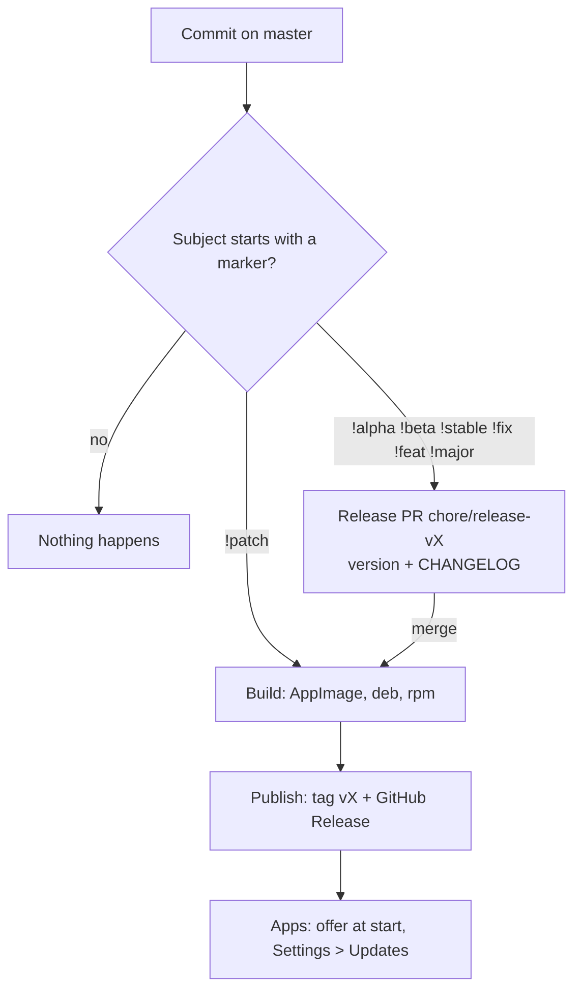

# Releases

A commit on `master` becomes a release by starting its subject with a marker. Workflow: `.github/workflows/release.yml`. Version rules: `scripts/release-version.mjs` (`node scripts/release-version.mjs --check` runs its self-test). Same scheme as Domus.



Step 1 builds nothing; the PR diff is the last look at the version and the notes. Step 2 names nothing until every bundle exists, so a failed release leaves no tag and no Release. Retry from the Actions tab: **Release → Run workflow → mode `release`**.

## Markers
The marker starts the commit subject; an optional scope and the message follow, for example `!alpha : First public build` or `!fix(install) : Handle spaces in paths`.

| Marker | From | To | |
|---|---|---|---|
| `!alpha` | nothing released | `0.0.1-alpha.1` | first release |
| `!alpha` | `0.0.1-alpha.1` | `0.0.1-alpha.2` | |
| `!beta` | `0.0.1-alpha.3` | `0.0.1-beta.1` | promote, same base |
| `!stable` | `0.0.1-beta.2` | `0.0.1` | promote, no bump |
| `!alpha` | `0.0.1` | `0.0.2-alpha.1` | next cycle |
| `!fix` | `1.4.2` | `1.4.3` | |
| `!feat` | `1.4.2` | `1.5.0` | |
| `!major` | `1.4.2` | `2.0.0` | |
| `!patch` | `0.0.2` | `0.0.2` | rebuild in place, no PR |

The current version is the last `v*` tag, or `0.0.0` when there is none. Several markers in one push: the strongest wins (`major > feat > fix > stable > beta > alpha > patch`). Release commits themselves (`chore(release): vX`) are not markers. These are the only commits that are not Conventional Commits; everything else still is.

```bash
git commit --allow-empty -m "!alpha : First public build"
git push            # opens the release PR; merge it to release
```

By hand: Actions → Release → Run workflow, with mode `pr` and a marker, `release` to retry a merged release, `patch` to rebuild the last one.

## Where the version lives
`scripts/set-version.mjs <version>` (run by the release PR) writes it to `app/package.json`, `app/src-tauri/tauri.conf.json`, `app/src-tauri/Cargo.toml` and `Cargo.lock`. Never edit these by hand for a release. The app reads it from `CARGO_PKG_VERSION` (Settings, update check); the bundle file names come from `tauri.conf.json`.

## What a release contains
`pnpm tauri build --bundles deb,rpm,appimage` on `ubuntu-22.04` (oldest supported runner, so the AppImage runs on more distros), after `pnpm test`. The build fails before publishing if the AppImage or deb is not named `*_<version>_amd64.*`, because the updater finds them by that name (see [07-updates.md](07-updates.md)). Alpha and beta releases are marked *pre-release* on GitHub. Notes are the `## vX` section of `CHANGELOG.md`, built from the commit subjects since the last tag; edit it in the release PR if it reads badly.

## One-time repository setup
- Settings → Actions → General → **Allow GitHub Actions to create and approve pull requests** (or add a `RELEASE_TOKEN` secret with a personal access token).
- The repository must be `aiyu-ayaan/Unpack` (the updater reads its releases), or change the constants in `app/src-tauri/src/updates.rs`.

## Not yet checked
- The workflow has been linted and its version logic self-tested, but never run on GitHub **(unverified)**.
- Whether tauri accepts a pre-release version such as `0.0.1-alpha.1` in the `.rpm` name and metadata **(unverified)**. If the rpm bundle fails, drop `rpm` from `--bundles` and the updater's rpm branch simply finds nothing.
- Bundles are unsigned; see the limits in `07-updates.md`.
